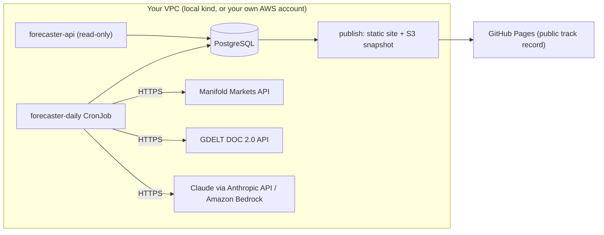

# LLM Forecast Pipeline

A daily forecasting system that asks Claude for calibrated probabilities on
public yes/no questions, scores itself honestly against real baselines, and
publishes a tamper-evident public track record — built to demonstrate a
production-grade, security-first, cost-aware approach to shipping an LLM
system, not just a model call behind an API.

> Not investment advice. Probabilities are model-generated and unverified.

## What it does

Every day, the pipeline:

1. Fetches open yes/no questions from [Manifold Markets](https://manifold.markets/).
2. Fetches recent news headlines about each question from [GDELT](https://www.gdeltproject.org/) (metadata only — article bodies are never downloaded or republished).
3. Asks Claude for a probability, five times, and takes the median.
4. Corrects the probability with a small calibrator fitted on past results (Platt scaling or isotonic regression, chosen by how much resolved history exists).
5. Records the forecast in a hash-chained database — editing any past forecast breaks the chain, so the history is tamper-evident without needing a blockchain.
6. Resolves questions once their outcome is known and scores every forecast (Brier score, log score, calibration/ECE, Murphy decomposition) against honest baselines (always-50%, base rate, market price).
7. Publishes the result as a static site via GitHub Pages.

## Why this design

| Decision | Reasoning |
|---|---|
| No fine-tuning | Most of the gain for a forecasting task comes from prompting, sampling, retrieval and calibration — all cheap and auditable. Fine-tuning needs data this project doesn't have yet and adds a model to secure and version. |
| Calibrate, don't retrain | A 2-parameter Platt fit (or isotonic once there's enough data) corrects systematic over/under-confidence without touching the underlying model. |
| Temporal train/test split | Calibration is fit on the earliest 70% of resolved forecasts and evaluated on the latest 30%. A random split would leak future information into training and overstate the result. |
| Headlines are untrusted input | A headline could contain "ignore your instructions." The prompt treats the news block as data only; the code strips control characters and delimiter tags before the text ever reaches the model; the model's output is parsed for exactly one number. |
| Burst-mode cloud deployment | Running Kubernetes/EKS continuously costs more per month than this project's budget allows for what is, most days, a few dozen API calls. Kubernetes development happens against a free local cluster (`kind`); AWS is used only for short, single-tenant validation bursts. See `docs/adr/`. |
| Single-tenant by design | This ships as a Terraform/Helm module meant to run inside *your own* AWS account. There's no vendor-operated control plane and no shared data plane — see `docs/adr/0004-tenant-isolation.md`. |

See `docs/adr/` for the full reasoning behind each non-obvious decision.

## Architecture



A default-deny egress `NetworkPolicy` blocks everything except DNS, the
database, and HTTPS (443) — no raw TCP, no plaintext HTTP. Plain Kubernetes
`NetworkPolicy` can't restrict *which* HTTPS hosts by name, so the "only
these three APIs" half of the isolation claim rests on code review of this
open-source repo, not the network layer alone — see
`docs/adr/0004-tenant-isolation.md` for the precise boundary.

## Project layout

```
src/forecaster/        the pipeline: ingest, forecast, resolve, publish, API
  sources/              Manifold + GDELT clients (sources/http.py is the one HTTP seam tests mock)
  llm/                  fake / Anthropic / Bedrock model clients behind one interface
  prompts/forecast_v1.md
notebooks/              six short notebooks teaching the scoring/calibration ideas this is built on
tests/                  network-blocked unit + integration tests
deploy/kind/            local Kubernetes dev cluster config
deploy/helm/forecaster/ the Helm chart (same chart, local or AWS)
infra/terraform/        VPC, EKS, RDS, S3, IAM — the AWS sandbox
docs/adr/               short decision records
docs/runbooks/          the exact commands for local k8s and the AWS sandbox burst
```

## Running it locally

```bash
python3 -m venv .venv && source .venv/bin/activate
make install
make test     # all tests pass, no network calls
make demo     # 100 fictional questions, fake model, builds public/index.html
make api      # serves 4 read-only endpoints at http://127.0.0.1:8000
```

To run against real data, copy `.env.example` to `.env`, add your own
Anthropic API key, and see `docs/runbooks/` for the daily cron setup.

## Security

- Secrets never enter the repository: local keys live in a git-ignored `.env`; AWS has no model API key at all (Bedrock uses an IAM role).
- `.claude/settings.json` + `CLAUDE.md` keep any AI assistant working in this repo from reading secrets, changing infrastructure, or adding commit attribution without a human approving each step.
- `make scan` (gitleaks) runs before every commit and in CI.
- See `docs/adr/` for the tenant-isolation and burst-mode cost decisions, and `docs/runbooks/` for the exact deploy/teardown sequence.

## License

Apache License 2.0 — see `LICENSE` and `NOTICE`.
